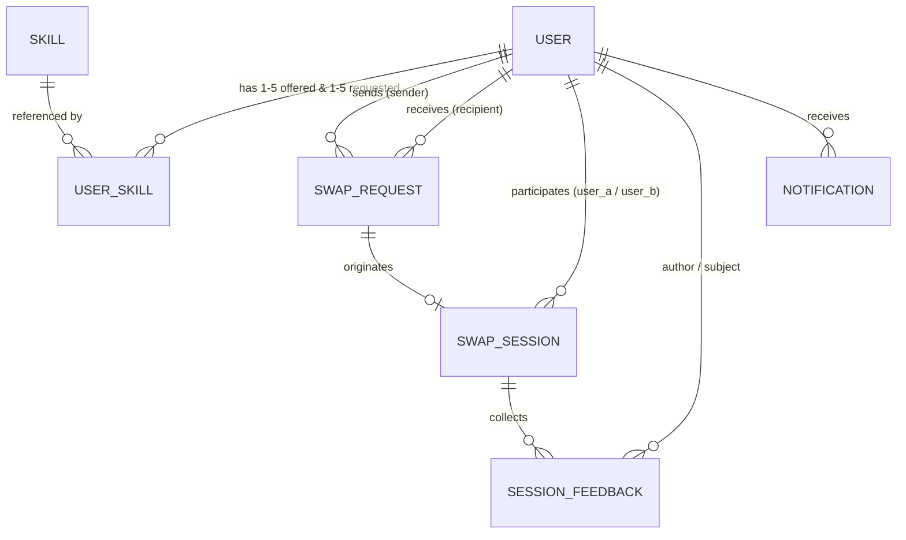

# Data Model: SkillSwap MVP

> Relational schema designed for PostgreSQL (Supabase) and Django ORM.

---

## 1. Entity Relationship Overview

---

## 2. Table Specifications

### `users` (`User`)
Extends Django's `AbstractUser`.

| Column | Type | Constraints / Attributes | Description |
|---|---|---|---|
| `id` | BigAutoField | Primary Key | Internal user ID |
| `username` | VarChar(150) | Unique | Username / handle |
| `email` | VarChar(254) | Unique, Index | User contact email (hidden from directory) |
| `password` | VarChar(128) | Not Null | Bcrypt / PBKDF2 hashed password |
| `display_name` | VarChar(100) | Not Null | User's public display name |
| `headline` | VarChar(120) | Blank allowed | One-line profession or title |
| `bio` | VarChar(300) | Max 300 chars | Short user introduction |
| `timezone` | VarChar(64) | Default `'UTC'` | IANA timezone (e.g., `'Asia/Karachi'`) |
| `published` | Boolean | Default `False` | True once 1+ offered and 1+ requested skills exist |
| `average_rating` | Decimal(3,2) | Default `0.00` | Running aggregate star score (1.00–5.00) |
| `total_completed_sessions` | Integer | Default `0` | Count of successfully concluded exchanges |
| `avatar_color` | VarChar(32) | Default `'emerald'` | UI accent color |
| `avatar_initials` | VarChar(4) | Blank allowed | Two-letter user badge abbreviation |
| `created_at` | DateTime | Auto now add | Account creation timestamp |
| `updated_at` | DateTime | Auto now | Profile update timestamp |

---

### `skills` (`Skill`)
Catalog of unique exchangeable topics.

| Column | Type | Constraints / Attributes | Description |
|---|---|---|---|
| `id` | BigAutoField | Primary Key | Internal skill ID |
| `name` | VarChar(80) | Unique, Index | Skill label (e.g., "Figma", "Conversational Spanish") |
| `category` | VarChar(60) | Index | Domain group (e.g., "Design", "Languages", "Tech") |

---

### `user_skills` (`UserSkill`)
Through-table associating users with their offered and requested skills.

| Column | Type | Constraints / Attributes | Description |
|---|---|---|---|
| `id` | BigAutoField | Primary Key | Internal mapping ID |
| `user_id` | BigInteger | FK $\to$ `users.id`, Cascade | User holding the skill |
| `skill_id` | BigInteger | FK $\to$ `skills.id`, Cascade | Referenced skill |
| `skill_type` | VarChar(16) | Check: `'offered'`, `'requested'` | Whether user teaches or learns this |
| `level` | VarChar(16) | Check: `'Beginner'`, `'Intermediate'`, `'Advanced'` | Self-reported proficiency level |
| *Constraint* | Unique | `(user_id, skill_id, skill_type)` | Prevent duplicate skill assignments |

---

### `swap_requests` (`SwapRequest`)
Bilateral match proposal between two users.

| Column | Type | Constraints / Attributes | Description |
|---|---|---|---|
| `id` | BigAutoField | Primary Key | Proposal identifier |
| `sender_id` | BigInteger | FK $\to$ `users.id`, Cascade | Proposer |
| `recipient_id` | BigInteger | FK $\to$ `users.id`, Cascade | Target peer |
| `sender_skill` | VarChar(80) | Not Null | Skill offered by sender |
| `recipient_skill` | VarChar(80) | Not Null | Skill requested from recipient |
| `intro_note` | VarChar(500) | Min 20, Max 500 chars | Pitch/message explaining mutual benefit |
| `status` | VarChar(20) | Default `'Pending'`, Check: `'Pending'`, `'Accepted'`, `'Declined'` | Request state |
| `decline_reason` | VarChar(300) | Nullable | Optional explanation when declined |
| `created_at` | DateTime | Auto now add | Timestamp when sent |
| `updated_at` | DateTime | Auto now | Timestamp of status change |

---

### `swap_sessions` (`SwapSession`)
Agreed exchange meeting scheduled between matched users.

| Column | Type | Constraints / Attributes | Description |
|---|---|---|---|
| `id` | BigAutoField | Primary Key | Session identifier |
| `swap_request_id` | BigInteger | OneToOne $\to$ `swap_requests.id`, Cascade | Originating swap request |
| `user_a_id` | BigInteger | FK $\to$ `users.id` | Proposer/Sender |
| `user_b_id` | BigInteger | FK $\to$ `users.id` | Recipient |
| `skill_taught_by_a` | VarChar(80) | Not Null | Topic taught by user A |
| `skill_taught_by_b` | VarChar(80) | Not Null | Topic taught by user B |
| `session_date` | Date | Nullable | Agreed meeting date |
| `session_time` | Time | Nullable | Agreed meeting start time |
| `duration_minutes` | Integer | Check: `30, 45, 60` | Duration of exchange |
| `meeting_url` | VarChar(500) | Valid URL format | Third-party conference link (Meet, Zoom) |
| `status` | VarChar(24) | Check: `'Pending Confirmation'`, `'Scheduled'`, `'Completed'`, `'No-Show Reported'`, `'Cancelled'` | Session state |
| `proposed_by_id` | BigInteger | FK $\to$ `users.id`, Nullable | Last user to submit time slot |
| `proposed_at` | DateTime | Nullable | Timestamp of proposal |
| `cancel_reason` | VarChar(300) | Nullable | Mandatory if cancelled |
| `cancelled_at` | DateTime | Nullable | Timestamp if cancelled |
| `cancelled_by_id` | BigInteger | FK $\to$ `users.id`, Nullable | User who cancelled |

---

### `session_feedbacks` (`SessionFeedback`)
Post-session evaluations submitted by participants.

| Column | Type | Constraints / Attributes | Description |
|---|---|---|---|
| `id` | BigAutoField | Primary Key | Feedback identifier |
| `session_id` | BigInteger | FK $\to$ `swap_sessions.id`, Cascade | Evaluated session |
| `user_id` | BigInteger | FK $\to$ `users.id` | Reviewer |
| `partner_id` | BigInteger | FK $\to$ `users.id` | Peer being evaluated |
| `session_took_place` | Boolean | Not Null | Whether the call occurred |
| `punctuality_rating` | Integer | Range `1..5`, Nullable if no-show | On-time arrival |
| `knowledge_sharing_rating` | Integer | Range `1..5`, Nullable if no-show | Teaching quality |
| `overall_rating` | Integer | Range `1..5`, Nullable if no-show | Overall satisfaction |
| `review_text` | VarChar(400) | Max 400 chars, Blank allowed | Optional testimonial |
| `no_show_details` | VarChar(500) | Nullable | Explanation if no-show reported |
| `submitted_at` | DateTime | Auto now add | Submission timestamp |
| *Constraint* | Unique | `(session_id, user_id)` | One review per participant |

---

### `in_app_notifications` (`InAppNotification`)
User alerts for swap actions.

| Column | Type | Constraints / Attributes | Description |
|---|---|---|---|
| `id` | BigAutoField | Primary Key | Notification ID |
| `user_id` | BigInteger | FK $\to$ `users.id`, Cascade | Target recipient |
| `title` | VarChar(120) | Not Null | Notification headline |
| `message` | VarChar(500) | Not Null | Detailed text |
| `notification_type` | VarChar(20) | `'request'`, `'acceptance'`, `'schedule'`, `'feedback'`, `'cancelled'` | Category |
| `read` | Boolean | Default `False` | Read receipt |
| `target_type` | VarChar(20) | Nullable (`'request'`, `'session'`) | Navigation hint |
| `target_id` | VarChar(40) | Nullable | Related object identifier |
| `created_at` | DateTime | Auto now add | Timestamp |
